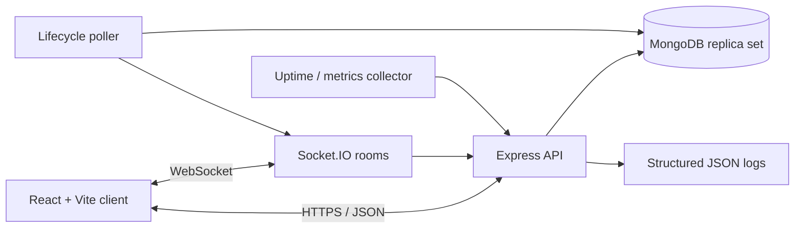

# RevBid — Architecture and Design Notes

## Goals
- Keep the client responsive while treating the API as the authority for prices, auction state, and deadlines.
- Support many concurrently active auctions without a process per auction.
- Make bid acceptance auditable and resistant to duplicate requests and races.
- Keep buyer and administrator permissions separate.

## Components

- **Client:** React Router, Axios, Socket.IO client. It displays server-reported auction state and uses socket events for quick updates. Demo cards are fallback content only and cannot accept bids.
- **API:** Express routes validate input with Zod, JWT authentication protects bidder operations, and role middleware protects admin operations. Helmet, CORS allowlisting, JSON body limits, and rate limiting provide baseline protections.
- **Database:** Mongoose models persist users, auctions, and bids. Indexes support auction status/end-time queries, user lookup, bid history, and idempotency.
- **Lifecycle worker:** a lightweight poller promotes scheduled auctions and closes expired auctions. It is deliberately simple for a single API instance.
- **Observability:** Pino JSON logs, request logging, `/health/live`, `/health/ready`, and lifecycle failure logs.

## Bid correctness
The client never decides whether a bid is valid. The server checks authentication, integer amount, auction status and dates, self-bidding, and the minimum increment. The auction update is conditional on the existing price and increment and occurs in a MongoDB transaction with the bid insert. A unique `(bidder, idempotencyKey)` index protects retries. Transactions require a replica set.

**Scale-up note:** MongoDB transactions plus a conditional update are suitable for this demonstration. For high bid rates, consider a single-writer partition per auction or a dedicated bidding service with partitioned event streams. Use optimistic concurrency / conditional updates, and load-test before selecting capacity. Socket.IO needs a Redis adapter or managed pub/sub when running multiple API instances.

## Security considerations
- Passwords are bcrypt-hashed (cost 12); password hashes are excluded from normal query results.
- JWT signing key must be a strong secret in a secret manager. Use short-lived tokens and refresh/revocation strategy for a real deployment.
- Public registration cannot set the `admin` role.
- Validate and limit user-controlled fields. Keep CORS restricted to known origins. Rate-limit auth and API routes.
- Never trust a client timer or client-reported current bid.
- Production requirements: HTTPS, security headers review, stronger distributed rate limiting, account verification and recovery, audit trail for admin changes, abuse detection, backup/restore drills, dependency scanning, secret rotation, and penetration testing.

## Known limitations and trade-offs
1. **Lifecycle poller is single-process.** It can run in duplicate across replicas; conditional status updates reduce damage, but a production deployment should use a distributed scheduler/lease or a dedicated worker with leader election.
2. **Readiness is intentionally basic.** Replace it with a live MongoDB ping and dependency status checks before production.
3. **No payment/escrow integration.** Winner selection is implemented, but payment, identity checks, deposits, refunds, title transfer, and dispute handling are outside scope.
4. **No image upload pipeline.** Listings accept image URLs. A real system should use object storage, signed upload URLs, malware checks, and image transformation.
5. **Admin UI is not yet complete.** Admin APIs are included; add a protected dashboard for listing creation and user moderation.
6. **Tests are starter-level.** Add integration and concurrency suites using an ephemeral replica set; do not represent this as production-certified without those tests.
7. **Demo UI content is fallback only.** Preview items are not database records and cannot be bid on.
8. **Authentication token storage uses localStorage in this demo.** Prefer secure, HttpOnly, SameSite cookies with CSRF protection for a public production deployment, depending on deployment topology.

## Test plan before public launch
- Unit: schema validation, bid increment rules, lifecycle transitions.
- Integration: register/login, protected routes, admin access, scheduled/live/ended state.
- Concurrency: submit N bids against the same price concurrently; assert one or more valid monotonic updates, no accepted bid below the winning price, and consistent bidCount/history.
- Idempotency: repeat the same bidder/key after timeout and ensure one bid record.
- Failure: abort transaction, MongoDB unavailable, socket reconnect, lifecycle worker restart.
- Security: auth brute force, invalid/expired JWT, role escalation, oversized payloads, CORS, injection attempts.
- Load: realistic active-auction fanout and websocket reconnect storms.

## Deployment outline
1. Provision MongoDB Atlas with replica-set transactions enabled and IP/network restrictions.
2. Deploy `server` as a Node 20+ service. Configure `MONGODB_URI`, `JWT_SECRET`, `CLIENT_ORIGIN`, `NODE_ENV=production`, and `LOG_LEVEL`.
3. Deploy `client` as a static Vite site. Build with `VITE_API_URL=https://<api-host>/api` and `VITE_SOCKET_URL=https://<api-host>`.
4. Configure HTTPS, exact CORS origin, WebSocket support, health checks, and log collection.
5. Promote a dedicated account to admin using a one-off controlled script; do not expose admin bootstrap publicly.
6. Seed reviewed listings, verify monitoring and backups, and run integration/concurrency tests before sharing credentials.

## Bid correctness

The client never decides whether a bid is valid. The server validates authentication, the bid amount, auction status and timing, self-bidding restrictions, and the minimum increment.

Bid acceptance uses a conditional MongoDB `findOneAndUpdate()` inside a transaction. The database update verifies the auction's eligibility and minimum bid amount before updating the current price, highest bidder, and bid count. The corresponding bid record is inserted using the same transaction session, so both operations commit or abort together.

The Bid schema defines a unique compound index on `(bidder, idempotencyKey)`. The route checks for previously processed requests and rejects reuse of an idempotency key with different request details. The deployed database must have this index successfully created for the database-level uniqueness guarantee to apply.

MongoDB transactions require a supported replica-set or sharded deployment.

## Logging

The application uses Pino for structured logging and `pino-http` for HTTP request logging. The logger configures a log level through `LOG_LEVEL` and redacts configured sensitive fields.

## Authentication and validation

Authentication routes use Zod to validate registration and login input. Password registration uses bcrypt hashing with a cost factor of 12. Auction routes also validate auction and bid input with Zod.
